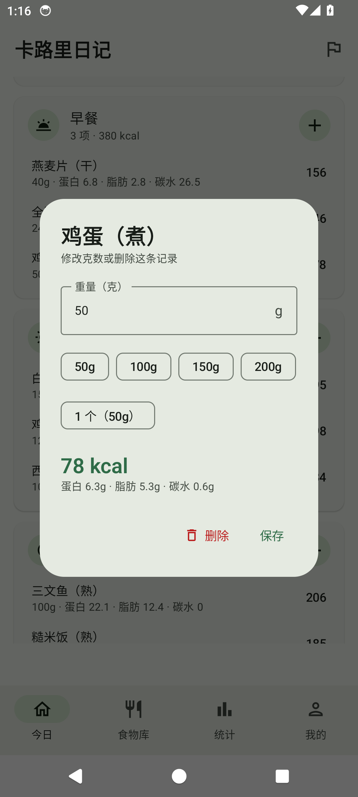
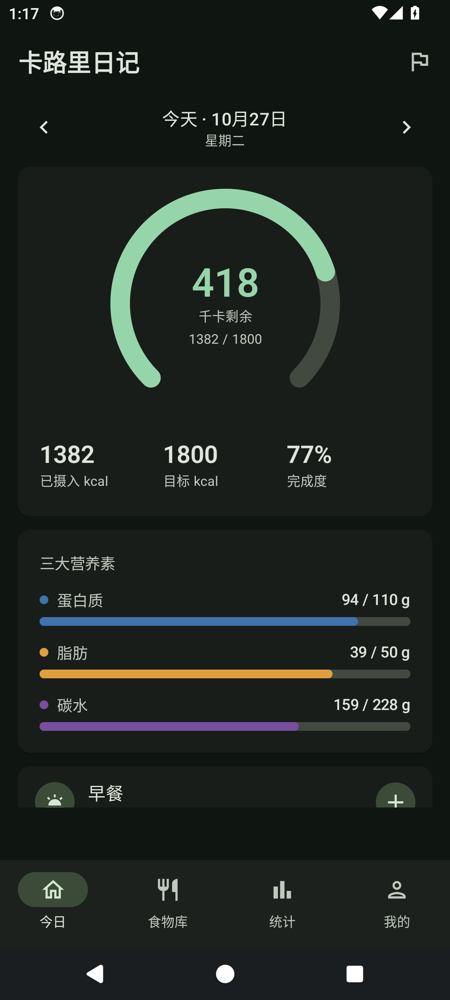

# 卡路里日记 · Calorie Diary

> 一个专注「记录要快」的安卓热量与营养素记录 App。Material 3 原生设计，完全离线可用，数据只存在你自己的手机里。


---

## 它解决什么问题

大多数热量记录 App 的问题是：记一顿饭要点五六层。这个 App 把这件事压到两步——**点餐次 → 搜食物 → 填克数**，其余交给界面。

减脂真正需要的不是精确到个位的卡路里，而是**能不能坚持记下去**。所以这里没有社交、没有打卡勋章、没有付费墙，只有一张每天都能快速填完的表格。

## 功能

### 今日打卡
- 早 / 午 / 晚 / 加餐四餐独立记录，每餐显示小计
- 270° 环形进度：剩余热量一眼可见，超标自动转红
- 蛋白质 / 脂肪 / 碳水三条独立进度条，颜色区分
- 点任意一条记录可修改克数或删除
- 支持回看和补记往前的日期

### 每日目标
- 热量 + 三大营养素四项目标，随时可改
- 两种作用域：**只改某一天**（今天想多吃一点），或**改掉每天默认**
- 内建 Mifflin-St Jeor 公式：填性别/年龄/身高/体重/活动量，自动算出基础代谢、日常消耗和推荐摄入
- 目标自检：三大营养素折算热量与热量目标差太多时会提醒

### 食物库
- 内置 **159 条常见食物**，覆盖主食、肉蛋、水产、蔬菜、水果、奶制品、豆制品、坚果、油脂、饮料、零食、快餐 12 类，每条都带中文名、英文名和常见份量
- 分类筛选 + 关键词模糊搜索（中英文都能搜）
- **自定义食物**：自己录一份，之后一直能用
- 所有营养值统一按「每 100 克可食部」，和你平时看的营养成分表同口径

### 联网查询
- 一次搜索同时查两个数据源：
  - **Open Food Facts** —— 开源食品数据库，覆盖全球包装食品，含中文商品名，无需 Key
  - **USDA FoodData Central** —— 美国农业部食物成分库，需免费申请 API Key（也可先填 `DEMO_KEY` 试用）
- 支持按名称搜索，结果可一键收藏进本地库

### 统计
- 最近 7 天热量柱状图，超标日自动标红
- 平均摄入、有记录天数、累计打卡项
- 本周营养素累计与目标对比

### 其他
- Material 3 动态取色（Android 12+ Material You），也可锁定品牌绿
- 深色模式：跟随系统 / 强制浅色 / 强制深色
- 支持横竖屏、深浅色、中文与英文系统语言

## 截图

<p align="center">
  
  
  
  
</p>

<p align="center">
  
  
  
  
</p>

截图来自 Android 14 模拟器（Pixel 6，1080×2400），界面语言中文、日间与夜间模式各一组。

## 数据来源

| 数据 | 来源 | 许可 |
|---|---|---|
| 内置食物库（热量与三大营养素） | [USDA FoodData Central · SR Legacy](https://fdc.nal.usda.gov/) | 公有领域 |
| 联网查询（包装食品） | [Open Food Facts](https://world.openfoodfacts.org/) | ODbL |
| 基础代谢公式 | Mifflin MD, St Jeor ST, et al. *A new predictive equation for resting energy expenditure in healthy individuals*. Am J Clin Nutr. 1990;51(2):241-7. | — |

内置库由 `tools/build_foods.py` 从 USDA SR Legacy 原始数据集生成，可复现：

```bash
# 下载 SR Legacy 数据集（约 12 MB）
curl -L -o sr_legacy.zip https://fdc.nal.usda.gov/fdc-datasets/FoodData_Central_sr_legacy_food_json_2021-10-28.zip
unzip sr_legacy.zip

python tools/build_foods.py FoodData_Central_sr_legacy_food_json_2021-10-28.json \
    app/src/main/assets/foods.json
```

脚本里 `SPEC` 列表定义了每个中文食物对应哪条 USDA 记录，匹配规则（必须词 + 排除词 + 最短描述优先）全部可见，方便你核对或自行扩充。

## 技术栈

| 层 | 选型 |
|---|---|
| 语言 | Kotlin 1.9.24 |
| UI | Jetpack Compose + Material 3（BOM 2024.09.03） |
| 导航 | Navigation Compose |
| 存储 | Room 2.6.1（KSP）+ DataStore Preferences |
| 网络 | OkHttp 4.12 |
| 构建 | AGP 8.5.2 / Gradle 8.7 / JDK 17 |

最小支持 Android 8.0（API 26），目标 API 34。没有引入任何分析、广告或推送 SDK。

## 构建

```bash
git clone https://github.com/yue56189/calorie-diary.git
cd calorie-diary

# 指向你自己的 Android SDK
echo "sdk.dir=/path/to/Android/Sdk" > local.properties

./gradlew assembleDebug
# 产物：app/build/outputs/apk/debug/app-debug.apk

./gradlew assembleRelease
# 产物：app/build/outputs/apk/release/app-release.apk
```

要求：JDK 17、Android SDK Platform 34、Build-Tools 34.0.0。

> **关于 release 签名**：仓库里的 `release` 构建暂时复用 debug keystore，方便你 clone 下来直接装。正式分发前请换成自己的 keystore。

## 项目结构

```
app/src/main/java/io/github/yue56189/caloriediary/
├── CalorieDiaryApp.kt          # Application，装配 DB / Repository / Prefs
├── MainActivity.kt
├── data/
│   ├── Models.kt               # FoodItem / DiaryEntry / DailyGoal
│   ├── Daos.kt                 # Room DAO
│   ├── AppDatabase.kt
│   ├── Repository.kt           # 数据读写与首启种子导入
│   ├── Prefs.kt                # DataStore：目标、档案、外观
│   ├── NutritionMath.kt        # BMR / TDEE / 推荐目标
│   └── RemoteFoodSource.kt     # Open Food Facts + USDA
└── ui/
    ├── MainScreen.kt           # 底部导航 + NavHost
    ├── MainViewModel.kt
    ├── TodayScreen.kt
    ├── LibraryScreen.kt
    ├── StatsScreen.kt
    ├── GoalScreen.kt
    ├── SettingsScreen.kt
    ├── FoodEditSheet.kt
    ├── components/             # 环形进度、营养素条、食物选择器
    └── theme/
```

## 已知限制

- 营养数据是平均值，同一种食物因品种、产地、烹饪方式差异可能有 20% 以上的浮动。
- Open Food Facts 的中文商品覆盖率一般，搜不到时建议换英文关键词，或自己录入自定义食物。
- USDA 默认的 `DEMO_KEY` 有速率限制（约每小时 30 次），重度使用请申请自己的 Key。
- 没有实现条码扫描、运动消耗、体重曲线，这些留给后续版本。

## 免责声明

本 App 仅用于个人饮食记录与参考，**不构成医疗建议**。热量与营养素的估算存在误差，如有减重、代谢或饮食相关疾病，请咨询医生或注册营养师。

## 许可

[MIT](LICENSE) © 2026 yue56189

内置食物数据来自 USDA FoodData Central（公有领域）；联网数据来自 Open Food Facts（ODbL），使用时请遵守其许可条款。
