# 卡路里日记 · Calorie Diary

> 一个专注「记录要快」的安卓热量与营养素记录 App。Material 3 原生设计，完全离线可用，数据只存在你自己的手机里。


**[⬇ 下载 APK（v1.1.0）](https://github.com/yue56189/calorie-diary/releases/latest)** · 要求 Android 8.0 及以上

---

## 它解决什么问题

大多数热量记录 App 的问题是：记一顿饭要点五六层。这个 App 把这件事压到两种输入——

- **挑食物**：点餐次 → 搜食物 → 填克数
- **说一句话**：`米饭 150` 或 `鸡胸肉 一掌`，直接算好热量记进去

减脂真正需要的不是精确到个位的卡路里，而是**能不能坚持记下去**。所以这里没有社交、没有打卡勋章、没有付费墙，只有一张每天都能快速填完的表格。

## 功能

### 今日打卡
- **早餐 / 早餐后加餐 / 午餐 / 午餐后加餐 / 晚餐 / 晚餐后加餐** 六段独立记录，每餐显示小计
- 270° 环形进度：剩余热量一眼可见，超标自动转红
- 蛋白质 / 脂肪 / 碳水三条独立进度条，颜色区分
- **热量预算卡**：显示「基础代谢 + 运动消耗 = 预算」，运动消耗可随手填（没运动就填 0）
- 点任意一条记录可改份量或删除
- **点日期打开日历**，可跳到任意一天回看或补记；左右箭头快速切换

### 快速记录（v1.1 新增）
- 一句话输入：`米饭 150`、`鸡胸肉 一掌`、`苹果`
- 自动在本地库与已启用的联网源里找最接近的食物，给出候选让你挑
- 直接算出热量与三大营养素，选好餐次一键记入
- 没写份量时用该食物的常用份量；写「一掌 / 一拳 / 一把」时按食物类别换算

### 每日目标
- 热量 + 三大营养素四项目标，随时可改
- **两种热量口径**：
  - **手动设定** —— 自己定一个数，不随运动和体重变化
  - **基础代谢 + 运动消耗** —— 预算 = BMR + 当天填的运动量，三大营养素按比例跟随
- 两种作用域：**只改某一天**（今天想多吃一点），或**改掉每天默认**
- 内建 Mifflin-St Jeor 公式：填性别/年龄/身高/体重/活动量，自动算出基础代谢与推荐摄入
- 目标自检：三大营养素折算热量与热量目标差太多时会提醒

### 食物库
- 内置 **159 条常见食物**，覆盖主食、肉蛋、水产、蔬菜、水果、奶制品、豆制品、坚果、油脂、饮料、零食、快餐 12 类，每条都带中文名、英文名和常见份量
- 分类筛选 + 关键词模糊搜索（中英文都能搜）
- **自定义食物**：自己录一份，之后一直能用
- 所有营养值统一按「每 100 克可食部」，和你平时看的营养成分表同口径

### 徒手估量（v1.1 新增）
没有厨房秤的时候按体积估——`一拳米饭 ≈ 130 g`、`一掌鸡胸肉 ≈ 100 g`、`一把青菜 ≈ 100 g`、`一拇指油 ≈ 10 g`、`一杯牛奶 ≈ 240 g`。

单位会按食物类别自动过滤：米饭不会给你「一片」，面包不会给你「一掌」。可用单位一览：

| 单位 | 适用 | 典型克数 |
|---|---|---|
| 一拳 | 主食 / 水果 / 肉蛋 / 水产 / 豆制品 | 80–150 g |
| 一掌 | 肉蛋 / 水产 / 豆制品 | 100–110 g |
| 一把（两手捧） | 蔬菜 / 水果 / 零食 | 40–120 g |
| 一捧（单手抓） | 坚果 / 零食 | 15–25 g |
| 一拇指 | 油脂 / 坚果 / 零食 | 8–12 g |
| 一杯 | 奶制品 / 饮料 | 240 g |
| 一汤匙 / 一茶匙 | 油脂 / 调味 / 零食 | 15 g / 5 g |
| 一片 | 面包类主食 / 火腿培根 | 20–30 g |
| 一个 | 蛋 / 馒头 / 包子 / 水果 | 50–180 g |

### 联网查询
一次搜索并行查三个源，结果合并去重：

| 数据源 | 说明 | 需要 Key |
|---|---|---|
| **天行数据 · 营养成分表**（国内） | 数据体系为《中国食物成分表》（谷类 / 畜肉类 / 蔬菜类 …），中文食物名命中率最高 | 是，[免费申请](https://www.tianapi.com/apiview/121) |
| **USDA FoodData Central** | 美国农业部食物成分库，英文名命中率更高 | 可选，可先用 `DEMO_KEY` |
| **Open Food Facts** | 开源包装食品库，含条码数据 | 否，可开关 |

> **关于「国内数据库」**：国内没有免费开放的国家级食物成分 API，《中国食物成分表》正版数据本身也不公开。所以这里接的是聚合接口（天行数据），数据体系就是食物成分表那一套，Key 由你自己申请、自己承担调用额度。

### 统计
- 最近 7 天热量柱状图，超标日自动标红
- 平均摄入、有记录天数、累计打卡项
- 本周营养素累计与目标对比

### 其他
- Material 3 动态取色（Android 12+ Material You），也可锁定品牌绿
- 深色模式：跟随系统 / 强制浅色 / 强制深色
- 支持横竖屏、深浅色、中文与英文系统语言

## 截图

<p align="center">
  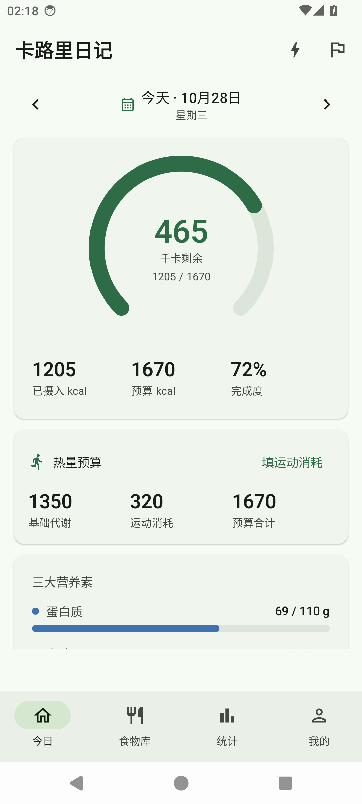
  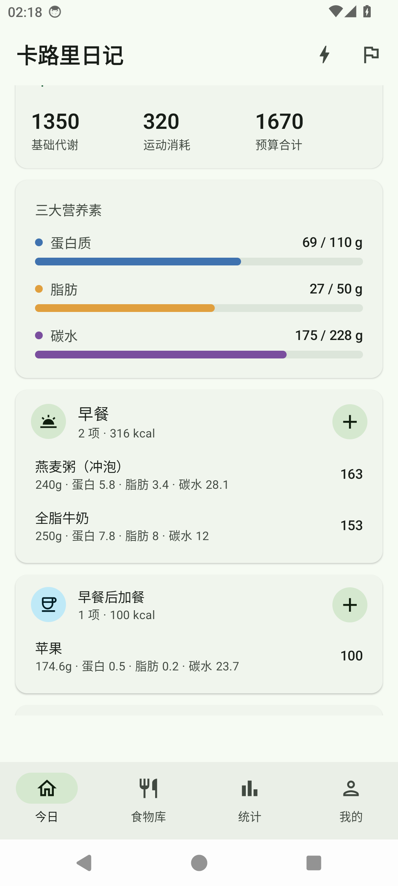
  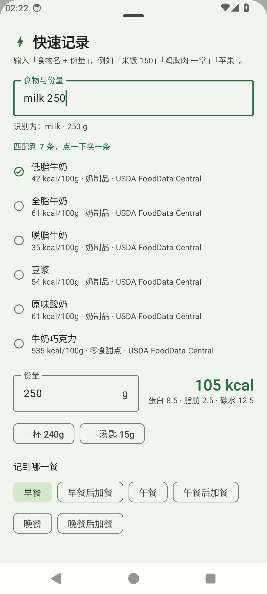
  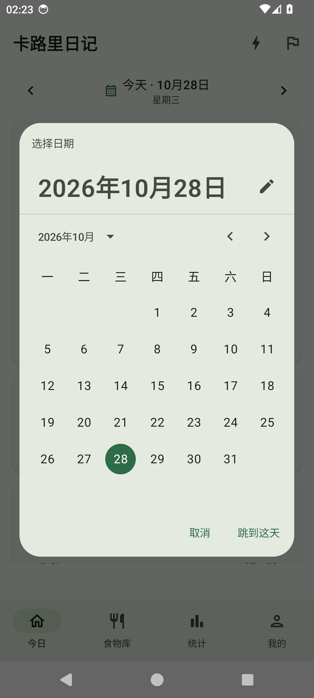
</p>

<p align="center">
  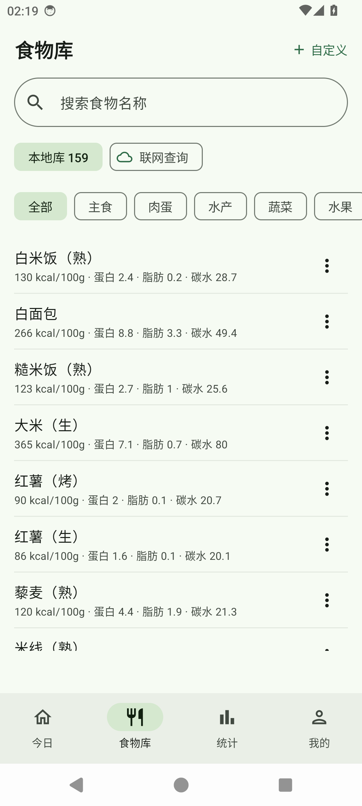
  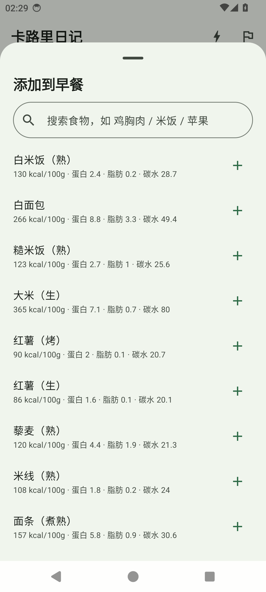
  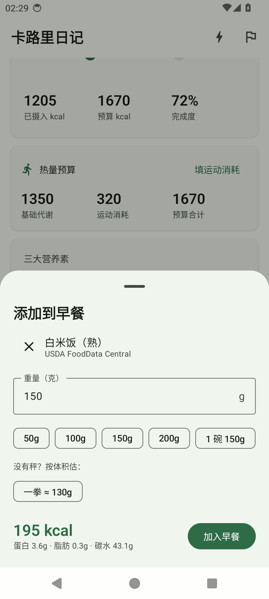
  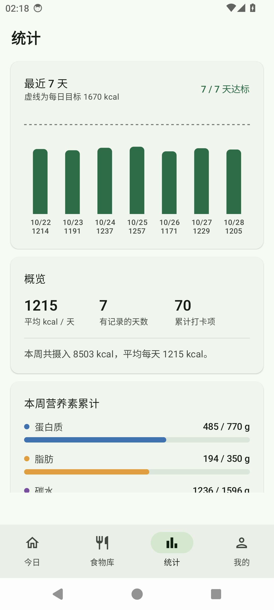
</p>

<p align="center">
  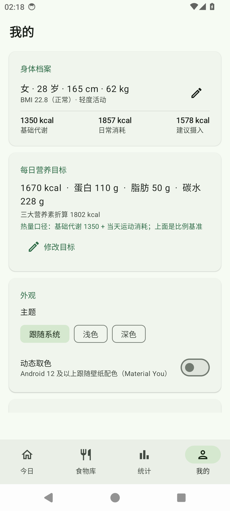
  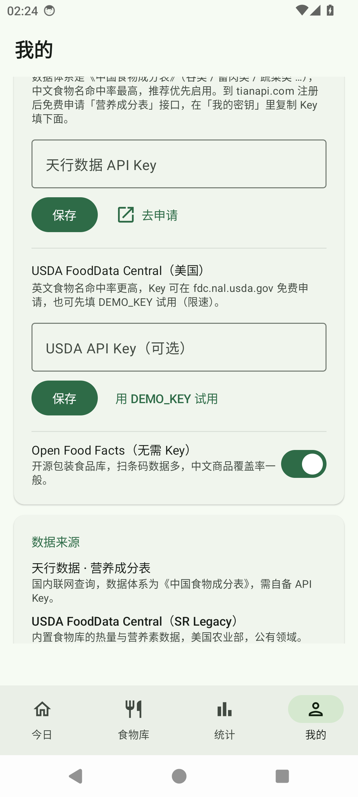
  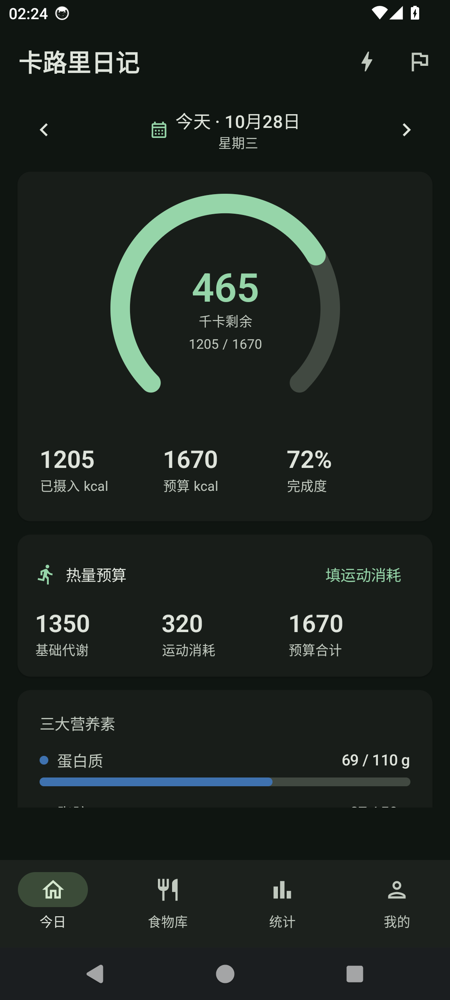
</p>

截图来自 Android 14 模拟器（1080×2400），界面语言中文、日间与夜间模式各一组。

## 数据来源

| 数据 | 来源 | 许可 |
|---|---|---|
| 内置食物库（热量与三大营养素） | [USDA FoodData Central · SR Legacy](https://fdc.nal.usda.gov/) | 公有领域 |
| 联网查询（国内食物） | [天行数据 · 营养成分表](https://www.tianapi.com/apiview/121)（《中国食物成分表》体系） | 商用接口，需自备 Key |
| 联网查询（包装食品） | [Open Food Facts](https://world.openfoodfacts.org/) | ODbL |
| 基础代谢公式 | Mifflin MD, St Jeor ST, et al. *A new predictive equation for resting energy expenditure in healthy individuals*. Am J Clin Nutr. 1990;51(2):241-7. | — |
| 徒手估量换算 | 常见家庭/食堂份量的中位数，见 `data/PortionUnits.kt` | — |

内置库由 `tools/build_foods.py` 从 USDA SR Legacy 原始数据集生成，可复现：

```bash
# 下载 SR Legacy 数据集（约 12 MB）
curl -L -o sr_legacy.zip https://fdc.nal.usda.gov/fdc-datasets/FoodData_Central_sr_legacy_food_json_2021-10-28.zip
unzip sr_legacy.zip

python tools/build_foods.py FoodData_Central_sr_legacy_food_json_2021-10-28.json \
    app/src/main/assets/foods.json
```

脚本里 `SPEC` 列表定义了每个中文食物对应哪条 USDA 记录，匹配规则（必须词 + 排除词 + 最短描述优先）全部可见，方便你核对或自行扩充。

## 技术栈

| 层 | 选型 |
|---|---|
| 语言 | Kotlin 1.9.24 |
| UI | Jetpack Compose + Material 3（BOM 2024.09.03） |
| 导航 | Navigation Compose |
| 存储 | Room 2.6.1（KSP）+ DataStore Preferences |
| 网络 | OkHttp 4.12 |
| 构建 | AGP 8.5.2 / Gradle 8.7 / JDK 17 |

最小支持 Android 8.0（API 26），目标 API 34。没有引入任何分析、广告或推送 SDK。

### 数据库版本

| 版本 | 变更 |
|---|---|
| v1 | 食物库 / 打卡记录 / 每日目标 |
| v2 | 新增 `daily_activity`（每日运动消耗）；餐次从 4 段扩到 6 段（纯代码改动，旧「加餐」记录归入「早餐后加餐」） |

`AppDatabase.MIGRATION_1_2` 已实现，从 1.0 覆盖安装不会丢数据。

## 构建

```bash
git clone https://github.com/yue56189/calorie-diary.git
cd calorie-diary

# 指向你自己的 Android SDK
echo "sdk.dir=/path/to/Android/Sdk" > local.properties

./gradlew assembleDebug
# 产物：app/build/outputs/apk/debug/app-debug.apk

./gradlew assembleRelease
# 产物：app/build/outputs/apk/release/app-release.apk
```

要求：JDK 17、Android SDK Platform 34、Build-Tools 34.0.0。

> **关于 release 签名**：仓库里的 `release` 构建暂时复用 debug keystore，方便你 clone 下来直接装。正式分发前请换成自己的 keystore。

## 项目结构

```
app/src/main/java/io/github/yue56189/caloriediary/
├── CalorieDiaryApp.kt          # Application，装配 DB / Repository / Prefs
├── MainActivity.kt
├── data/
│   ├── Models.kt               # FoodItem / DiaryEntry / DailyGoal / DailyActivity / Meal
│   ├── PortionUnits.kt         # 一拳一掌的换算表
│   ├── Daos.kt                 # Room DAO
│   ├── AppDatabase.kt          # 含 1→2 迁移
│   ├── Repository.kt           # 数据读写与首启种子导入
│   ├── Prefs.kt                # DataStore：目标、档案、外观、数据源 Key
│   ├── NutritionMath.kt        # BMR / TDEE / 预算 / 推荐目标
│   └── RemoteFoodSource.kt     # 天行数据 + USDA + Open Food Facts
└── ui/
    ├── MainScreen.kt           # 底部导航 + NavHost
    ├── MainViewModel.kt
    ├── TodayScreen.kt          # 环形进度、预算卡、六段餐次、日历
    ├── LibraryScreen.kt
    ├── StatsScreen.kt
    ├── GoalScreen.kt           # 目标 + 热量口径
    ├── SettingsScreen.kt
    ├── FoodEditSheet.kt
    ├── components/             # QuickAddSheet / FoodPicker / 环形进度 / 营养素条
    └── theme/
```

## 已知限制

- 营养数据是平均值，同一种食物因品种、产地、烹饪方式差异可能有 20% 以上的浮动。
- 天行数据的免费额度有限（按次计），重度使用需自行充值；USDA 的 `DEMO_KEY` 限速约每小时 30 次。
- Open Food Facts 的中文商品覆盖率一般，搜不到时建议换英文关键词，或自己录入自定义食物。
- 徒手估量的克数是人群平均值，手掌大小因人而异——它解决的是「没法称」而不是「精确」。
- 「基础代谢 + 运动消耗」口径下的运动消耗需要自己填（App 不读健康数据），懒得填就会偏低。
- 没有实现条码扫描、运动消耗自动同步、体重曲线，这些留给后续版本。

## 更新日志

- **v1.1.0**
  - 新增国内数据源《中国食物成分表》体系（天行数据），设置页可填 Key
  - 新增「快速记录」：输入「食物名 + 克数/一掌」自动查询并算热量
  - 点首页日期打开日历，可跳任意一天
  - 加餐拆成「早餐后 / 午餐后 / 晚餐后」三段（数据库自动迁移）
  - 热量预算支持「基础代谢 + 运动消耗」，运动消耗按天手填
  - 份量支持一拳 / 一掌 / 一把 / 一捧 / 一拇指 / 一杯 / 一汤匙 / 一茶匙 / 一片 / 一个
- **v1.0.0** 首个版本

## 免责声明

本 App 仅用于个人饮食记录与参考，**不构成医疗建议**。热量与营养素的估算存在误差，如有减重、代谢或饮食相关疾病，请咨询医生或注册营养师。

## 许可

[MIT](LICENSE) © 2026 yue56189

内置食物数据来自 USDA FoodData Central（公有领域）；联网数据来自 Open Food Facts（ODbL）与天行数据，使用时请遵守各自的许可与条款。
